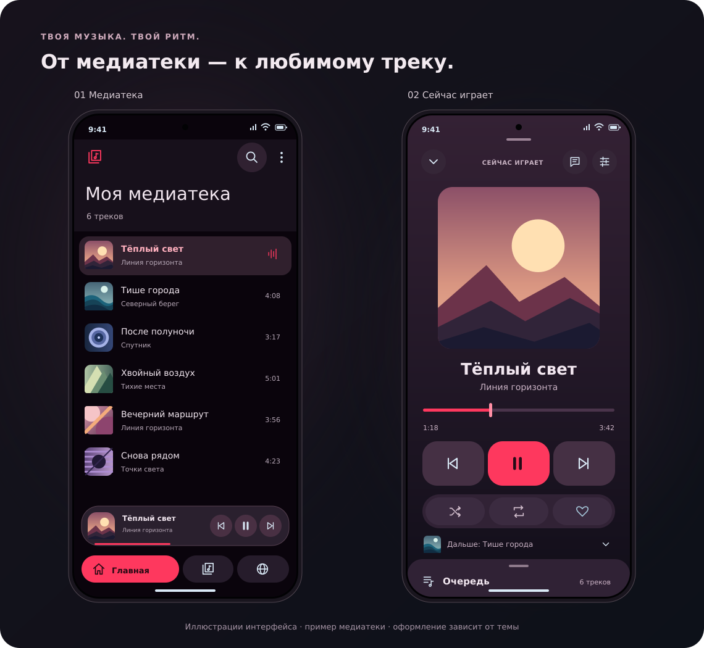
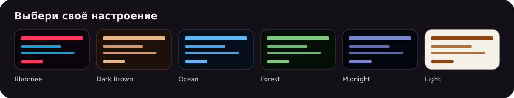

<div align="center">
  
  <h1>Glowpath</h1>
  <p><strong>Твоя музыка. Твой ритм.</strong></p>
  <p>Android-плеер для музыки на устройстве:<br/>медиатека, очередь, тексты песен и оформление под тебя.</p>
  <p>
    <a href="https://github.com/qrrrv/Glowpath-app/actions/workflows/build.yml"></a>
    
    
    
  </p>
  <p>
    <a href="#install"><strong>Скачать APK</strong></a> ·
    <a href="#features">Возможности</a> ·
    <a href="#gestures">Управление</a> ·
    <a href="#development">Собрать из исходников</a>
  </p>
</div>

<p align="center">
  
</p>

<p align="center"><sub>Иллюстрации по текущей разметке приложения. Треки и обложки вымышлены; вид на устройстве зависит от темы, настроек и размера экрана.</sub></p>

<a id="features"></a>

## Что умеет Glowpath

| | Возможности |
| --- | --- |
| **Медиатека** | Добавление отдельных файлов, поиск музыки на устройстве, поиск по названию и исполнителю, альбомы и свои плейлисты. |
| **Плеер** | Большая обложка, мини-плеер, воспроизведение в фоне и управление через системные медиакнопки. |
| **Очередь** | Следующий трек, изменение порядка, удаление из очереди и сохранение очереди в плейлист. |
| **Тексты песен** | Обычные и синхронизированные тексты, локальные LRC-файлы, отображение вместо обложки и редактор. |
| **Звук** | Эквалайзер, скорость воспроизведения, перемешивание, повтор и таймер сна. |
| **Оформление** | Material 3, цветовые темы, собственная палитра, шрифты, форма элементов и настройки анимаций. |
| **Онлайн-поиск** | Поиск треков через каталог Deezer с проверкой доступности файла на Hitmos. |
| **Интеграции** | Данные текущего трека через локальный HTTP API и мост для ExteraGram. |

Проект активно меняется. Сборки из `main` предназначены для знакомства с приложением и проверки изменений; отдельные функции могут требовать доработки на конкретном устройстве.

<a id="install"></a>

## Установить на Android

1. Открой **[Actions → Build APK](https://github.com/qrrrv/Glowpath-app/actions/workflows/build.yml)**.
2. Выбери завершившуюся сборку ветки `main` с зелёной отметкой.
3. В разделе **Artifacts** скачай **GlowPath-release**. Для скачивания артефактов нужен вход в GitHub.
4. Распакуй ZIP и установи находящийся внутри APK на устройство с **Android 8.0 или новее**.

**Release** подходит для обычного использования и оценки плавности. **GlowPath-debug** — отладочная сборка для разработки.

При первом запуске дай приложению доступ к аудиофайлам. В меню медиатеки выбери **«Найти всю музыку»** или добавь отдельный файл. Нажми на трек, чтобы начать воспроизведение.

<a id="gestures"></a>

## Управление под рукой

| Действие | Как сделать |
| --- | --- |
| Найти трек в своей библиотеке | Нажми лупу в верхней панели медиатеки. |
| Развернуть плеер | Нажми на мини-плеер над нижней навигацией. |
| Свернуть большой плеер | Потяни вниз по обложке или свободной области; движение вверх в том же жесте возвращает плеер. |
| Переключить трек | Смахни обложку влево или вправо либо используй кнопки. |
| Открыть очередь | Потяни нижнюю панель очереди вверх или нажми строку «Дальше». |
| Показать текст песни | Нажми кнопку текста в верхней части плеера. |
| Выбрать несколько треков | Удерживай трек в медиатеке, затем отмечай остальные. |

Внутри открытой очереди и области текста вертикальные жесты используются для их собственного управления и прокрутки.

## Оформление под тебя

<p align="center">
  
</p>

В настройках доступны готовые темы и редактирование своей палитры. Можно менять шрифт, размеры текста, скругления и анимации. Выше показана часть цветовых наборов из приложения; итоговый вид также зависит от выбранного стиля интерфейса.

## Если что-то непонятно

<details>
<summary><strong>Будет ли работать без интернета?</strong></summary>

Добавленные локальные аудиофайлы воспроизводятся без сети. Интернет нужен для онлайн-поиска, загрузки файлов и получения текстов песен из внешних источников. Тексты также могут браться из локальных LRC-файлов и кэша.

</details>

<details>
<summary><strong>Почему медиатека пустая?</strong></summary>

Проверь разрешение на доступ к музыке в настройках Android. Затем открой меню медиатеки → **«Найти всю музыку»**. Отдельный файл можно добавить через системный выбор документов.

</details>

<details>
<summary><strong>Почему онлайн-поиск ничего не нашёл?</strong></summary>

Приложение получает до десяти кандидатов из Deezer и ищет для каждого соответствующий MP3 на Hitmos. В выдачу попадают только результаты с совпадающими после нормализации названием и исполнителем и найденной ссылкой на файл.

Доступность зависит от обоих сервисов. Если каталог недоступен, файл отсутствует или названия версий трека отличаются, результат может быть пустым. Это не влияет на воспроизведение музыки, уже добавленной с устройства.

</details>

<details>
<summary><strong>Где тексты песен?</strong></summary>

Открой большой плеер и нажми кнопку текста. Синхронизация строк или слов доступна, когда найден текст с временными метками. Для других треков может отображаться обычный текст; свои правки можно внести в редакторе.

</details>

<details>
<summary><strong>Как использовать текущий трек в других приложениях?</strong></summary>

В репозитории есть [описание Now Playing API](docs/NOW_PLAYING_API.md) и [инструкция к плагину ExteraGram](exteragram_plugin/README_EXTERAGRAM_BRIDGE.txt).

HTTP API работает, пока жив процесс Glowpath. Для доступа на том же устройстве используется адрес `http://127.0.0.1:8765`. Плагин ExteraGram получает метаданные и обложку через ContentProvider и формирует карточку трека на своей стороне.

</details>

<a id="development"></a>

## Для разработчиков

**Нужно:** JDK 17, Android SDK 36 и Gradle Wrapper из репозитория. Проект можно открыть в Android Studio; путь к установленному SDK укажи в локальном `local.properties`.

```bash
git clone https://github.com/qrrrv/Glowpath-app.git
cd Glowpath-app
chmod +x gradlew
./gradlew testDebugUnitTest assembleDebug
```

На Windows используй `gradlew.bat`. Отладочный APK появится в `app/build/outputs/apk/debug/`.

GitHub Actions запускает тесты жестов и собирает Release и Debug APK. Подписание сборок настроено в [workflow](.github/workflows/build.yml); локальная команда выше создаёт обычную отладочную сборку.

<details>
<summary><strong>Стек и устройство проекта</strong></summary>

| Часть | Технологии |
| --- | --- |
| Интерфейс | Kotlin 2.0.21, Jetpack Compose, Material 3, Navigation Compose |
| Состояние и фоновые задачи | ViewModel, StateFlow, Kotlin Coroutines |
| Воспроизведение | Android MediaPlayer, MediaSession, foreground service |
| Обложки и анимации | Coil, Palette, Lottie |
| Сетевой поиск | Jsoup, Deezer, Hitmos |
| Проверки | JUnit, Robolectric, Compose UI tests |

```text
app/src/main/java/com/musicplayer/
├── data/          # треки, настройки, тексты песен
├── repository/    # локальная библиотека и онлайн-поиск
├── service/       # фоновое воспроизведение
├── bridge/        # обмен данными с ExteraGram
├── ui/            # экраны, компоненты, темы
└── viewmodel/     # состояние и действия пользователя

app/src/test/      # проверки жестов плеера
docs/              # документация и иллюстрации
exteragram_plugin/ # плагин карточки текущего трека
```

</details>

## Нашёл проблему или есть идея?

[Создай issue](https://github.com/qrrrv/Glowpath-app/issues/new) и укажи модель устройства, версию Android и сборку приложения. Для ошибки полезны шаги воспроизведения и описание того, что ожидалось. Для проблем с анимацией особенно помогает короткая запись экрана.

---

<p align="center"><sub>Glowpath · музыка на устройстве, оформление по вкусу.</sub></p>
